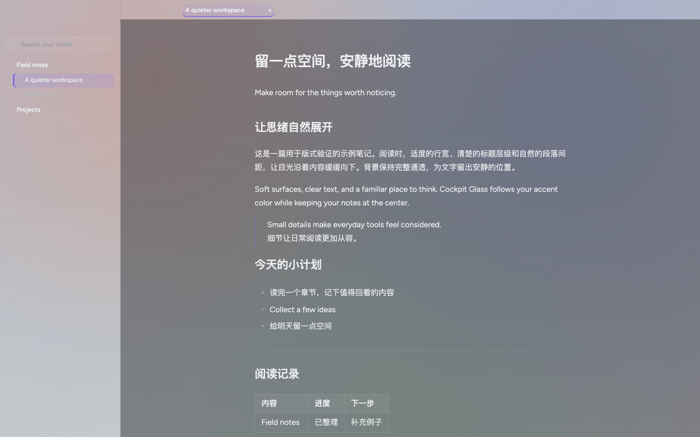

<h1 align="center">Cockpit Glass</h1>

<h3 align="center">A standalone light &amp; dark frosted-glass theme for <a href="https://obsidian.md">Obsidian</a></h3>

<p align="center">
  <a href="https://github.com/ZephyrHaven/cockpit-glass/releases/latest"></a>
  
  
  
</p>

**English** · [简体中文](./README.zh-CN.md) · [Architecture](./docs/ARCHITECTURE.md) · [Audit](./docs/AUDIT.md)

One continuous sheet of frosted glass across the whole window, quiet navigation, gentle control feedback and comfortable reading typography. It follows your accent color and needs **no plugins, remote fonts, images or network requests**.

## Screenshots

<p align="center"></p>
<p align="center"><em>Light mode — follows your system accent color</em></p>

<p align="center"></p>
<p align="center"><em>Dark mode</em></p>

> Captured from the real macOS interface with synthetic content. The Cockpit tab and AI shortcut come from the optional Cockpit Dashboard plugin — the theme works fully on its own.

## Main features

<details>
<summary><b>1. Glassy, single-window design</b></summary>

The entire window shares one continuous frosted surface. Navigation panes, tabs, controls and dialogs sit on it with soft hairlines and subtle hover feedback. The glass field is painted once on a static layer, so scrolling long notes and hovering images never re-blend the backdrop per frame — no smear, ghosting or color blocks under native macOS translucency.
</details>

<details>
<summary><b>2. Follows your accent color</b></summary>

Both light and dark modes read the accent from **Settings → Appearance → Accent color**. Nothing is hard-coded, so highlights, selections, links and dividers take on whatever color you choose.
</details>

<details>
<summary><b>3. Comfortable typography with bundled Figtree</b></summary>

Figtree (SIL OFL, embedded — offline, no network) drives the Latin glyphs of the interface and reading text; Chinese automatically falls back to the system black face (PingFang on macOS) so mixed Chinese + English stays visually consistent. Any font you pick in Appearance still overrides it.
</details>

<details>
<summary><b>4. Reading surface option (Style Settings)</b></summary>

With the optional [Style Settings](https://github.com/mgmeyers/obsidian-style-settings) plugin: **Settings → Style Settings → Cockpit Glass → Reading surface**.

- **Mist** (default) — a half-opaque layer under top-level notes keeps text legible on any wallpaper.
- **Clear glass** — shows the window glass directly.
- **Solid** — fully opaque.

Without the plugin the theme uses Mist. When the system *Reduce transparency* is on, notes are always solid.
</details>

<details>
<summary><b>5. Readable secondary text &amp; components</b></summary>

List markers, placeholders, unchecked checkboxes and other faint text reach about 5.7:1 contrast on solid surfaces and at least 3:1 on glass; muted text is 7:1 or higher. Code blocks and table headers get their own surface; callouts, tags, properties, embeds, graph, canvas and PDF follow the theme palette and radius.
</details>

<details>
<summary><b>6. Menus, tabs &amp; accessibility</b></summary>

Menus, the command palette, suggestions and hover previews share one floating style with an accent-tinted selection; root and sidebar tabs use the same active style. *Reduce transparency* turns every glass layer solid; forced-colors mode keeps selection, focus and floating borders; on mobile, touch targets are 44px and inputs 16px to avoid iOS zoom.
</details>

## Install

1. Download the ZIP from [Releases](https://github.com/ZephyrHaven/cockpit-glass/releases/latest).
2. Unzip the `Cockpit Glass` folder into your vault's `.obsidian/themes/` folder.
3. Pick **Cockpit Glass** in **Settings → Appearance → Themes**.

Prefer manual files? Copy the release's `theme.css` and `manifest.json` into `.obsidian/themes/Cockpit Glass/`. No Node.js, build step or plugin is needed for end users.

On macOS, **Translucent window** is optional — notes sit on a light reading mist over the native window glass, so text stays legible on any wallpaper. Windows, Linux, fullscreen and detached settings windows use solid fallbacks (CSS cannot blur the desktop wallpaper there). To uninstall, choose another theme and delete this theme's folder; the theme stores no user data.

## Support

<p align="center">
  <a href="https://afdian.com/a/zephyrhaven"></a>
</p>

If Cockpit Glass is useful to you, you can support its ongoing development on [Afdian](https://afdian.com/a/zephyrhaven). Thank you!

## Maintain &amp; deploy

This is a source project; the install result is just two files:

```text
src/*.css → build.js → theme.css + dist/
                              ├── theme.css
                              ├── manifest.json
                              ├── Cockpit-Glass-<version>.zip
                              └── SHA256SUMS.txt
```

Edit the modules under `src/`; their cascade order is declared in `theme.config.json`. Root `theme.css` is generated and committed for the community directory — never edit it by hand.

```sh
npm ci
npm test            # build + validate + tooling tests
npm run release:check
npm run test:ui     # browser checks (needs local host CSS + Chromium)
```

One-command deployment on macOS/Linux builds, validates, backs up the installed theme, then copies only the two runtime files:

```sh
bash deploy.sh --vault /path/to/vault
```

Add `--config-dir custom-config` for a custom config directory, or copy `deploy.local.example.json` to `deploy.local.json` and run `bash deploy.sh` with no arguments. On Windows: `npm ci` once, then `npm run deploy -- --vault C:/path/to/vault`. Backups live in `.cockpit-backups/`. See [architecture](./docs/ARCHITECTURE.md) and [releasing](./docs/RELEASING.md).

MIT License. Original attribution is preserved in [LICENSE](./LICENSE).
