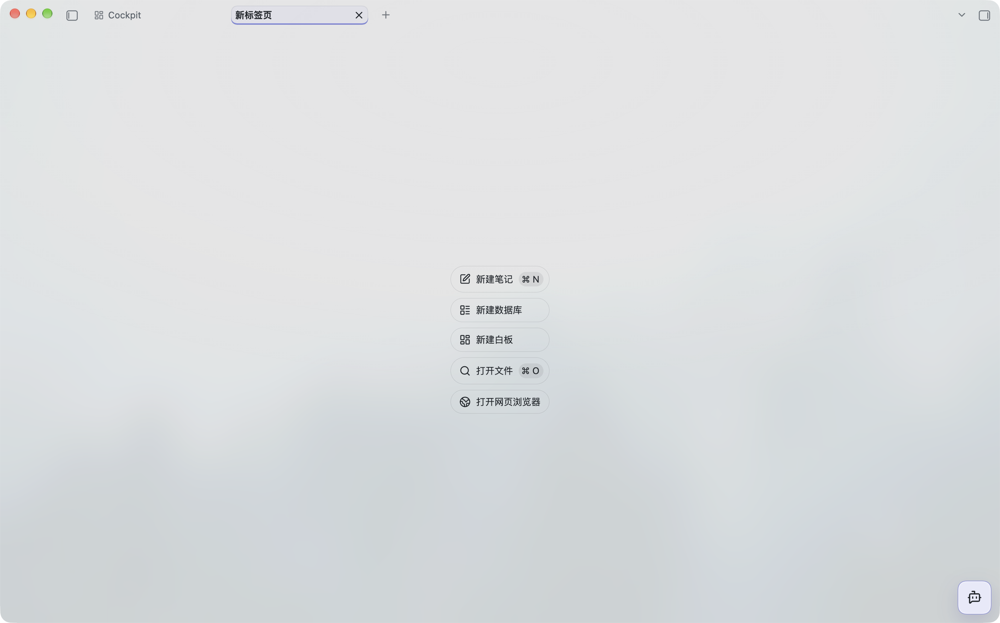
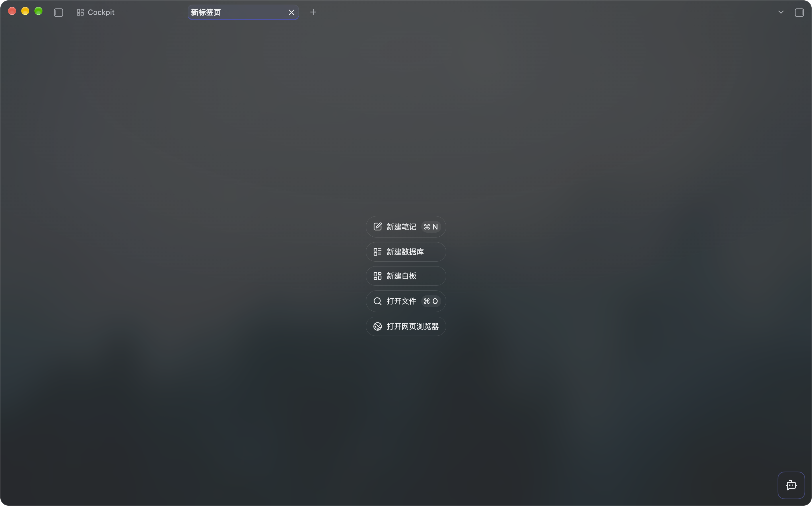

# Cockpit Glass

A standalone light and dark theme with a frosted navigation rail, subtle controls and clear reading surfaces. It follows your accent color and needs no plugins, remote assets or network requests.

[中文说明](./README.zh-CN.md) · [Download](https://github.com/ZephyrHaven/cockpit-glass/releases/latest) · [Architecture](./docs/ARCHITECTURE.md) · [Audit](./docs/AUDIT.md)

Version **1.3.1**, for app version **1.14.0+**. The theme previously shipped as 1.2.0 inside Cockpit Dashboard. Community directory review is pending; GitHub releases can be installed manually.

## Screenshots

### Light mode



### Dark mode



Screenshots show the actual macOS interface. The Cockpit tab and AI shortcut are provided by the optional Cockpit Dashboard plugin; the theme works independently.

## Install

Download the ZIP from [Releases](https://github.com/ZephyrHaven/cockpit-glass/releases/latest), then place its `Cockpit Glass` folder inside your vault configuration directory's `themes/` folder (normally `.obsidian/themes/`). Alternatively, copy the release's two individual files, `theme.css` and `manifest.json`, into `themes/Cockpit Glass/`.

Select **Cockpit Glass** in **Settings → Appearance → Themes**. No Node.js, build step or plugin is needed for end users.

On macOS, **Translucent window** is optional. Notes, dialogs and search palettes retain clear surfaces. Other platforms, fullscreen and detached settings use solid fallbacks; CSS cannot provide native desktop wallpaper blur there. Windows/Linux and mobile visual acceptance are still pending. To uninstall, choose another theme and remove this theme's folder; no user data is stored by the theme.

## Maintain and deploy

This is a source project, with generated installation files:

```text
src/*.css → build.js → theme.css + dist/
                              ├── theme.css
                              ├── manifest.json
                              ├── Cockpit-Glass-1.3.1.zip
                              └── SHA256SUMS.txt
```

Edit the modules under `src/`; their cascade order is declared in `theme.config.json`. Root `theme.css` is generated and committed for the community directory. Never edit it directly. The project is self-contained and does not build from the plugin repository.

Requires Node.js 22+ and npm for development:

```sh
npm ci
npm test
npm run release:check
```

One-command deployment on macOS/Linux installs missing build dependencies, builds, validates, backs up the installed theme, then copies only the two runtime files:

```sh
bash deploy.sh --vault /path/to/vault
```

Use `--config-dir custom-config` for a vault with a different configuration directory. To reuse a local default, copy `deploy.local.example.json` to `deploy.local.json` and set `themeDir` to your theme folder; then run **`bash deploy.sh`** without arguments. The local file is ignored by Git. `COCKPIT_THEME_DIR` also works.

On Windows, run `npm ci` once, then `npm run deploy -- --vault C:/path/to/vault`; the Node deployment implementation is shared across platforms. Backups live under the installed theme's `.cockpit-backups/`. Existing newer themes, another theme's files and concurrent deployments are refused. Theme preferences and unrelated files are preserved. See [architecture](./docs/ARCHITECTURE.md) for recovery and locking details.

## Verify interactions

```sh
node scripts/extract-host-css.mjs /path/to/host.asar
npx playwright install chromium
npm run test:ui
```

Local host CSS and synthetic screenshots stay in ignored `output/`. They are not community-store screenshots. Tooling tests exercise backup, rollback, locks, external edits and release packaging; browser tests use a synthetic DOM with the local host stylesheet. Real-device acceptance is recorded separately in [the audit](./docs/AUDIT.md).

`npm run release:check` validates the GitHub release package. `npm run community:check` checks the screenshot selected by `communityScreenshot` in `theme.config.json`. The selected screenshot must also exist in the commit tagged for the release. See [publishing instructions](./docs/RELEASING.md).

## Support

If Cockpit Glass is useful to you, you can support its ongoing development and maintenance on [Afdian](https://afdian.com/a/zephyrhaven). Thank you for your support!

MIT License. Original attribution is preserved in [LICENSE](./LICENSE). Cockpit Dashboard remains optional; its bundled installer can retain its older offline snapshot without replacing a newer installed theme.
