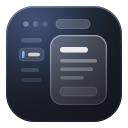
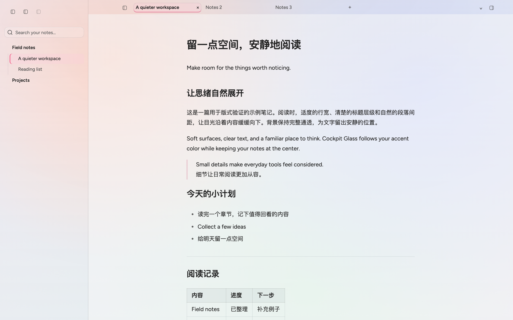

<div align="center">



<h1>Cockpit Glass</h1>

<p><strong>A serene optical-glass &amp; architectural theme for Obsidian — refined with or without translucency.</strong></p>

<p>
  <a href="https://github.com/ZephyrHaven/cockpit-glass/releases/latest">
    
  </a>
  
  
  
  <a href="./LICENSE">
    
  </a>
</p>

<p>
  <strong>English</strong> ·
  <a href="./README.zh-CN.md">简体中文</a> ·
  <a href="#preview">Preview</a> ·
  <a href="#highlights">Highlights</a> ·
  <a href="#installation">Install</a> ·
  <a href="./docs/ARCHITECTURE.md">Architecture</a>
</p>

</div>

---

**Cockpit Glass** is a standalone light & dark theme for [Obsidian](https://obsidian.md). It pairs a calm, recessed outer shell with an elevated rounded reading sheet, tactile pill tabs, crisp file-tree hierarchy, and publication-grade Markdown typography — engineered to look just as deliberate in **opaque desktop mode** as it does over **native macOS translucency**.

> [!TIP]
> **100% standalone & offline.** No required plugins, no remote fonts or images, no runtime scripts, no persistent `backdrop-filter` smear, and zero `!important` overrides so your personal CSS snippets stay in control.

<br />

## Preview

<p align="center">
  
  <br />
  <sub><strong>Light Mode</strong> — Warm alabaster frame, luminous porcelain sheet &amp; system accent</sub>
</p>

<br />

<p align="center">
  
  <br />
  <sub><strong>Dark Mode</strong> — Deep obsidian frame, elevated graphite canvas &amp; crisp specular edges</sub>
</p>

> [!NOTE]
> Captured from macOS using synthetic content. The Cockpit tab and AI shortcut shown in the screenshot come from the optional Cockpit Dashboard plugin — **Cockpit Glass works completely independently**.

<br />

## Highlights

<table>
  <tr>
    <td width="50%" valign="top">
      <h3>Crafted for Opaque &amp; Glass Alike</h3>
      <p><strong>Without translucency</strong>, warm alabaster / deep obsidian chrome frames a softly elevated, rounded document sheet — never a flat fallback. <strong>With macOS translucency</strong>, a static frosted field eliminates scroll ghosting while letting wallpaper tones breathe softly through.</p>
    </td>
    <td width="50%" valign="top">
      <h3>Restrained, System-First Accent</h3>
      <p>Reads your accent directly from <strong>Settings → Appearance → Accent color</strong>. Structural surfaces stay calm and neutral, reserving your accent for deliberate touches: active file markers, tab icons, focus rings, checkboxes, and links.</p>
    </td>
  </tr>
  <tr>
    <td width="50%" valign="top">
      <h3>Tactile Tabs &amp; Airy File Tree</h3>
      <p>Pipe dividers and harsh chrome seams are gone. Active tabs float as crisp neutral pills with delicate top catch-lights; active files pair an elevated pill with an independent rounded vertical accent mark and compact extension badges.</p>
    </td>
    <td width="50%" valign="top">
      <h3>Editorial Typography &amp; Bundled Figtree</h3>
      <p>Shared <code>1.7</code> line height across Reading, Live Preview, and Source modes. Embedded offline <strong>Figtree</strong> (SIL OFL) pairs seamlessly with native CJK sans-serifs, alongside open-edge tables, soft blockquotes, fade-out dividers, and layered code blocks.</p>
    </td>
  </tr>
  <tr>
    <td width="50%" valign="top">
      <h3>Unified Floating Surfaces</h3>
      <p>Command palette, quick switcher, context menus, popovers, and Settings share one calibrated floating material — subtle hairlines, multi-layered elevation shadows, tactile keycap badges, and refined row selection.</p>
    </td>
    <td width="50%" valign="top">
      <h3>Accessibility &amp; Native Respect</h3>
      <p>WCAG AA contrast across normal, muted, and faint ink (≥ 5:1 on solid). Full support for <em>Reduce transparency</em>, <em>Reduce motion</em>, <em>Forced colors</em>, RTL mirroring, stacked tabs, native drag/rename states, and 44px mobile touch targets.</p>
    </td>
  </tr>
</table>

<br />

## Reading Surface & Platform Modes

Optional [Style Settings](https://github.com/mgmeyers/obsidian-style-settings) support is built right in (**Settings → Style Settings → Cockpit Glass → Reading surface**):

| Mode | Best for | Visual behavior |
| :--- | :--- | :--- |
| **Mist** *(default)* | macOS with Translucent Window | Rounded frosted-crystal reading sheet (~55% opacity) keeps body text effortlessly readable on any wallpaper. |
| **Clear glass** | Minimalists on subtle wallpapers | Removes the reading sheet backdrop and frame so notes float directly on the continuous glass field. |
| **Solid** | Maximum contrast & focus | Fully opaque document sheet over translucent chrome — automatically enforced whenever system *Reduce transparency* is enabled. |
| **Opaque Desktop** | Windows, Linux, Fullscreen & non-translucent macOS | Seamless recessed outer shell framing an elevated porcelain (light) or graphite (dark) document sheet. |

<br />

## Installation

### From GitHub Releases *(Recommended)*

1. Download the latest `Cockpit-Glass-<version>.zip` from [**Releases**](https://github.com/ZephyrHaven/cockpit-glass/releases/latest).
2. Extract the `Cockpit Glass` folder into your vault's `.obsidian/themes/` directory.
3. Open **Settings → Appearance → Themes** and select **Cockpit Glass**.

### Manual Files

Copy `theme.css` and `manifest.json` from the release into `.obsidian/themes/Cockpit Glass/`. End users need no Node.js, build step, or helper plugins.

> [!TIP]
> On macOS, **Translucent window** is completely optional — try both modes in **Settings → Appearance** and pick whichever feels calmer for your desktop. To uninstall, switch to another theme and delete the `Cockpit Glass` folder; the theme stores no user data.

<br />

## Support

<p align="center">
  <a href="https://afdian.com/a/zephyrhaven">
    
  </a>
</p>

<p align="center">
  <sub>If Cockpit Glass makes your daily writing quieter and more enjoyable, consider supporting ongoing maintenance on <a href="https://afdian.com/a/zephyrhaven">Afdian</a> or starring the repository.</sub>
</p>

<br />

## Development & Deployment

<details>
<summary><strong>Build pipeline, verification suite, and one-command local deploy</strong></summary>

<br />

Styles are maintained in modular CSS files under `src/` with explicit cascade order in `theme.config.json`. Never edit the generated root `theme.css` by hand.

```text
src/*.css ──▶ build.js (Lightning CSS) ──▶ theme.css + dist/
                                                       ├── theme.css
                                                       ├── manifest.json
                                                       ├── Cockpit-Glass-<version>.zip
                                                       └── SHA256SUMS.txt
```

```sh
npm ci
npm test                 # build + manifest/CSS constraints + deployment tests
npm run build:check      # verify generated outputs match src/
npm run release:check    # verify release notes, archive, checksums & screenshot
npm run test:ui          # 190+ Chromium checks against local host CSS
```

Deploy directly to a local vault (builds, validates, backs up previous files to `.cockpit-backups/`, and replaces only `theme.css` and `manifest.json` atomically):

```sh
# macOS / Linux
bash deploy.sh --vault /path/to/vault

# Custom config directory
bash deploy.sh --vault /path/to/vault --config-dir custom-config

# Windows
npm run deploy -- --vault C:/path/to/vault
```

Or copy `deploy.local.example.json` to `deploy.local.json` (git-ignored) and run `bash deploy.sh` with no arguments. For engineering boundaries and release checklists, see [Architecture](./docs/ARCHITECTURE.md), [Releasing](./docs/RELEASING.md), and [Audit](./docs/AUDIT.md).

</details>

---

<p align="center">
  <sub>Released under the <a href="./LICENSE">MIT License</a> · Crafted by <a href="https://github.com/ZephyrHaven">ZephyrHaven</a></sub>
</p>
