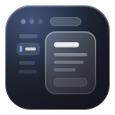
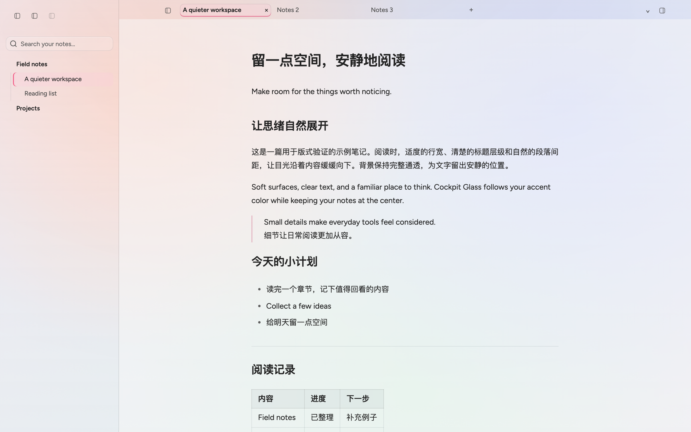
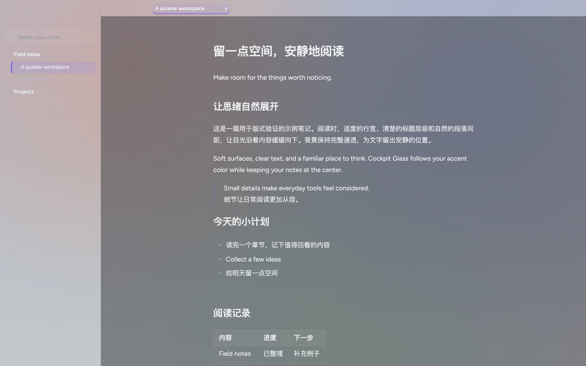

<div align="center">



<h1>Cockpit Glass</h1>

<p><strong>为 Obsidian 打造的克制光学玻璃与建筑感主题 —— 无论是否开启半透明，同样精致通透。</strong></p>

<p>
  <a href="https://github.com/ZephyrHaven/cockpit-glass/releases/latest">
    
  </a>
  
  
  
  <a href="./LICENSE">
    
  </a>
</p>

<p>
  <a href="./README.md">English</a> ·
  <strong>简体中文</strong> ·
  <a href="#效果预览">效果预览</a> ·
  <a href="#设计亮点">设计亮点</a> ·
  <a href="#安装方式">安装方式</a> ·
  <a href="./docs/ARCHITECTURE.md">工程结构</a>
</p>

</div>

---

**Cockpit Glass** 是一款独立维护的 [Obsidian](https://obsidian.md) 深浅双色主题。它以沉静内敛的外框托起圆角悬浮文档页，搭配带细高光的中性胶囊标签、清晰透气的文件树层级与出版物级正文排版 —— 既能在 **macOS 原生半透明窗口**下展现纯净的毛玻璃层次，在**关闭半透明或 Windows / Linux 实色模式**下同样具备完整的桌面级质感。

> [!TIP]
> **完全独立，纯离线运行。** 无需安装任何辅助插件，无远程字体、图片或网络请求，不使用会拖慢滚动的常驻 `backdrop-filter`，也不含任何 `!important`，完全尊重你的自定义 CSS 片段。

<br />

## 效果预览

<p align="center">
  
  <br />
  <sub><strong>浅色模式</strong> — 暖调雪花石膏外框、瓷白文档面，自动跟随系统强调色</sub>
</p>

<br />

<p align="center">
  
  <br />
  <sub><strong>深色模式</strong> — 深曜石外框托起微抬升石墨画布，配以克制的顶部细高光</sub>
</p>

> [!NOTE]
> 截图取自 macOS 真实界面并使用合成内容。图中的 Cockpit 标签与 AI 入口来自可选的 Cockpit Dashboard 插件 —— **Cockpit Glass 主题本身可完全独立使用**。

<br />

## 设计亮点

<table>
  <tr>
    <td width="50%" valign="top">
      <h3>实色与毛玻璃双重高完成度</h3>
      <p><strong>关闭半透明时</strong>，以暖雪花石膏（浅）与深曜石（深）外框托起圆角悬浮文档页，告别发灰扁平的兜底观感；<strong>开启 macOS 半透明时</strong>，静止玻璃底场彻底杜绝滚动拖影与重影，同时让壁纸光色自然透出。</p>
    </td>
    <td width="50%" valign="top">
      <h3>克制且忠实的强调色体系</h3>
      <p>直接读取「<strong>设置 → 外观 → 强调色</strong>」，绝不写死刺眼色相。界面主体保持纯净中性，仅在活动文件竖标、活动标签图标、焦点轮廓、复选框与链接等关键位置点缀你的强调色。</p>
    </td>
  </tr>
  <tr>
    <td width="50%" valign="top">
      <h3>立体胶囊标签与清爽文件树</h3>
      <p>告别生硬的竖线分隔符与厚重横线。活动标签呈带顶部细高光的立体中性胶囊；文件树以轻柔分组底面配合独立圆角竖标、紧凑扩展名徽章，长文件名可读区域更宽裕。</p>
    </td>
    <td width="50%" valign="top">
      <h3>舒适阅读排版与内嵌 Figtree</h3>
      <p>阅读、实时预览与源码模式统一 <code>1.7</code> 行高与清晰标题尺度。离线内嵌 <strong>Figtree</strong>（SIL OFL）驱动拉丁字形，自动衔接系统黑体（macOS 苹方），搭配开放式表格、柔底引用块、渐隐分割线与高质感代码块。</p>
    </td>
  </tr>
  <tr>
    <td width="50%" valign="top">
      <h3>统一的多层投影浮层</h3>
      <p>命令面板、快速切换、右键菜单、悬浮预览与设置窗口共用同一套浮层语言 —— 细腻描边、柔和多层阴影、立体键帽样式快捷键与克制的选中高亮。</p>
    </td>
    <td width="50%" valign="top">
      <h3>无障碍与原生交互兼容</h3>
      <p>正文、次要与辅助文字在实色底上均达 WCAG AA 对比度（≥ 5:1）。完整适配<em>降低透明度</em>、<em>减少动态效果</em>、<em>强制颜色</em>、RTL 镜像、堆叠标签、原生拖拽/重命名状态与移动端 44px 触控尺寸。</p>
    </td>
  </tr>
</table>

<br />

## 阅读面与平台模式

内置可选的 [Style Settings](https://github.com/mgmeyers/obsidian-style-settings) 选项（**设置 → Style Settings → Cockpit Glass → 阅读面**）：

| 模式 | 适用场景 | 视觉表现 |
| :--- | :--- | :--- |
| **薄雾** *(默认)* | macOS 开启半透明窗口 | 圆角磨砂晶体阅读页（约 55% 透明度），壁纸再丰富正文依然清晰好读。 |
| **清透** | 搭配素雅壁纸的极简用户 | 卸除阅读页底色与外框，让文字直接落在一整块连续通透的窗口玻璃上。 |
| **实色** | 高对比度专注阅读 | 顶层文档页完全不透明；系统开启「降低透明度」时会自动切换为此模式。 |
| **实色桌面模式** | Windows、Linux、全屏及未开半透明的 macOS | 沉静统一的外框托起微抬升的瓷白（浅色）或石墨（深色）圆角文档页。 |

<br />

## 安装方式

### 通过 GitHub Releases 安装 *(推荐)*

1. 前往 [**Releases**](https://github.com/ZephyrHaven/cockpit-glass/releases/latest) 下载最新的 `Cockpit-Glass-<版本>.zip`。
2. 解压后，将 `Cockpit Glass` 文件夹放入库的 `.obsidian/themes/` 目录下。
3. 在 Obsidian 打开 **设置 → 外观 → 主题**，选择 **Cockpit Glass**。

### 手动放置文件

也可直接下载 Release 中的 `theme.css` 与 `manifest.json`，放入 `.obsidian/themes/Cockpit Glass/`。普通用户无需 Node.js、构建步骤或任何插件。

> [!TIP]
> 在 macOS 上，「半透明窗口」完全可选 —— 你可以在 **设置 → 外观** 中自由开关对比。卸载只需切换回其他主题并删除 `Cockpit Glass` 文件夹，本主题不会存储任何用户数据。

<br />

## 支持开发

<p align="center">
  <a href="https://afdian.com/a/zephyrhaven">
    
  </a>
</p>

<p align="center">
  <sub>如果 Cockpit Glass 让你的日常写作与阅读更安静顺手，欢迎通过 <a href="https://afdian.com/a/zephyrhaven">爱发电</a> 支持持续维护，或给仓库点一颗 Star。</sub>
</p>

<br />

## 源码维护与本地部署

<details>
<summary><strong>查看构建链路、校验命令与一键本地部署</strong></summary>

<br />

所有视觉源码均位于 `src/`，拼接顺序在 `theme.config.json` 中显式声明。根目录 `theme.css` 由构建脚本自动生成并随仓库提交，请勿手动编辑。

```text
src/*.css ──▶ build.js (Lightning CSS) ──▶ theme.css + dist/
                                                       ├── theme.css
                                                       ├── manifest.json
                                                       ├── Cockpit-Glass-<版本>.zip
                                                       └── SHA256SUMS.txt
```

```sh
npm ci
npm test                 # 构建 + 清单/CSS 约束校验 + 部署回归测试
npm run build:check      # 校验产物与源码逐字节同步
npm run release:check    # 校验发布说明、压缩包、校验和与社区截图
npm run test:ui          # 基于本地宿主 CSS 与 Chromium 运行 190+ 项浏览器检查
```

一键部署到本地库（自动构建、校验、将旧版本备份至 `.cockpit-backups/`，并仅原子替换 `theme.css` 与 `manifest.json`）：

```sh
# macOS / Linux
bash deploy.sh --vault /path/to/vault

# 指定自定义配置目录
bash deploy.sh --vault /path/to/vault --config-dir custom-config

# Windows
npm run deploy -- --vault C:/path/to/vault
```

也可复制 `deploy.local.example.json` 为 `deploy.local.json`（已忽略，不入库）后直接运行 `bash deploy.sh`。更多维护约定见[工程结构](./docs/ARCHITECTURE.md)、[发布流程](./docs/RELEASING.md)与[验收记录](./docs/AUDIT.md)。

</details>

---

<p align="center">
  <sub>基于 <a href="./LICENSE">MIT 许可</a> 开源 · 由 <a href="https://github.com/ZephyrHaven">ZephyrHaven</a> 维护</sub>
</p>
